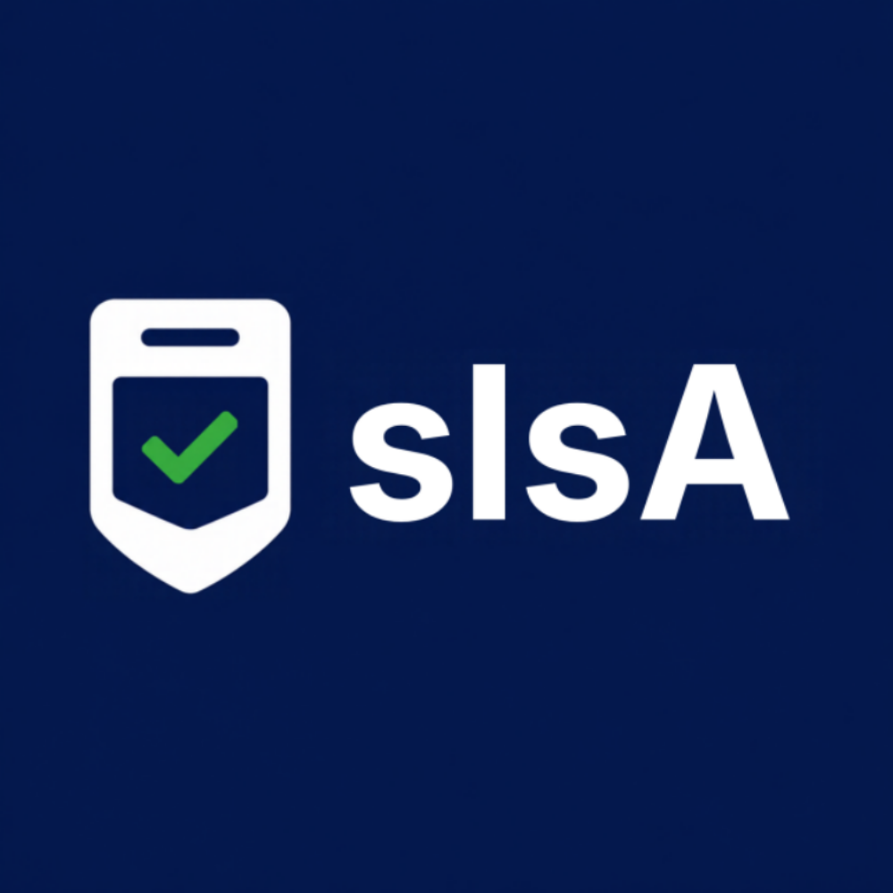

# sIsA · Cédula electrónica que sabe más y muestra menos



**Platanus Hack 26: Caracas ft. Yummy Project · Track 🤝 Trust · team-1**

🔗 Demo desplegada: https://sisa-vej8.onrender.com/

## Qué es

Hoy validar identidad en Venezuela implica fotocopiar la cédula y dejar datos completos en bases que nadie controla. **sIsA** es un prototipo de cédula electrónica con chip NFC que **guarda más datos pero muestra menos**: cada atributo va firmado por el emisor (ECDSA P-256) y el terminal solo puede leer lo que su rol permite.

- Un **bar** solo comprueba "mayor de 18"; nunca recibe datos personales, solo el resultado.
- Un **hospital** puede leer tipo de sangre y contacto con consentimiento del ciudadano.
- Un **paramédico** puede leerlos en emergencia sin consentimiento, pero el ciudadano **siempre** recibe el aviso.

## Cómo funciona

1. El terminal (ESP32 + lector RC522) pide un dato y el ciudadano acerca su cédula (MIFARE 1K).
2. El firmware verifica **sin internet** firma, vigencia, revocación y permiso del rol.
3. El ciudadano autoriza o rechaza por **WhatsApp (Kapso)**; sin respuesta en 60 s se rechaza. Responder BLOQUEAR revoca la cédula al instante.
4. El comercio ve solo el resultado; el evento, con un handle seudónimo, va al historial del dueño (se borra a los 30 días).

## Piezas

| Pieza | Tecnología |
|---|---|
| Cédula y terminal | ESP32, PlatformIO, MFRC522, micro-ecc |
| Guardián anti-manipulación | PIC16F13145: bloquea el lector si abren la carcasa o el firmware deja de latir |
| Gateway | Go (puerto serie, cola de eventos en disco) |
| API y base de datos | Go, chi, pgx, Postgres, SSE, desplegados en Render |
| Billetera y verificador | PWAs en React + TypeScript con QR dinámico firmado, verificable sin red |
| Paneles del emisor y comercio | React, Vite, Tailwind |

## Correrlo

```bash
cp .env.example .env.local        # completar DATABASE_URL y claves
go -C api test ./...              # pruebas
go -C api run ./cmd/api           # API en :8080
npm --prefix web ci && npm --prefix web run dev
```

## Documentación

Índice en [`docs/README.md`](docs/README.md) (brief, SRS, casos de uso, arquitectura, seguridad, despliegue y pruebas). Descripción completa en [`project-description.md`](project-description.md).

## Limitaciones declaradas

MIFARE es clonable; una cédula real usaría un chip seguro con autenticación activa. La billetera lo mitiga con un desafío firmado cada pocos segundos.

## Equipo

- Luis Arturo Becerra Dalponte ([@old-lx](https://github.com/old-lx))
- Isabella Noy ([@isabellanoy](https://github.com/isabellanoy))
- Manuela Panzarelli ([@mozarelly](https://github.com/mozarelly))
- Samuel David Sánchez Chacón ([@samuelsanchez01](https://github.com/samuelsanchez01))
- Matias Silveira ([@hetairoii](https://github.com/hetairoii))
