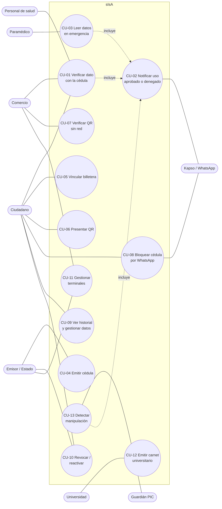

# 03 · Casos de uso

## Diagrama

## Fichas

### CU-01 · Verificar un dato con la cédula (flujo estrella)
- **Actores:** ciudadano, terminal (comercio/registro/salud/tránsito).
- **Precondición:** terminal configurado con rol y atributo; cédula emitida; el gateway envió la hora.
- **Flujo principal:**
  1. El terminal anuncia "{local} pide: {dato}". El ciudadano acerca la cédula y el firmware lee UID e índice (handle).
  2. Se autentica en los sectores del atributo con la clave del rol y lee el registro.
  3. Verifica firma del emisor, vigencia y que el handle no esté revocado.
  4. Resultado `01`: la pantalla del comercio muestra "Esperando autorización" y el ciudadano recibe por WhatsApp "{local} pide '{dato}'. ¿Lo compartes?".
  5. El ciudadano toca **Sí**: la pantalla del comercio muestra el visto bueno.
  6. Se envía el evento `verif` a la API (vía gateway) → CU-02.
- **Flujos alternos:**
  - A1 (`06`): el ciudadano toca **No** o no responde en 60 s; no se entrega el dato y se registra `06` con el handle.
  - A2 (`05`): el rol no tiene la clave del sector; no se lee el dato.
  - A3 (`02`): la firma no coincide (tarjeta alterada o copiada).
  - A4 (`03`): el handle está en la lista de revocación.
  - A5 (`04`): la credencial está vencida.
  - A6: la tarjeta es virgen o ajena (sin índice): se informa "sin cédula"; no hay handle, por lo que no se envía aviso.
- **Postcondición:** evento guardado; el comercio solo ve el resultado.

### CU-02 · Notificar el uso por WhatsApp (aprobado o denegado)
- **Actores:** API, Kapso, ciudadano.
- **Disparador:** `POST /api/events` con `t = verif`.
- **Flujo principal:** la API busca al dueño del handle; si tiene teléfono y avisos activos, arma el mensaje según `res` y lo envía por Kapso en segundo plano.
- **Mensajes:** 01 autorizado · 02 firma inválida · 03 cédula bloqueada · 04 vencida · 05 sin permiso · 06 rechazaste compartir. Todos con botón **Bloquear cédula**, salvo 03.
- **Alternos:** sin teléfono/avisos apagados/handle desconocido → no se envía; botones fallan → texto con "Responde BLOQUEAR"; Kapso falla → se registra el error y el evento ya está guardado.

### CU-03 · Leer datos en emergencia
- **Actor:** paramédico con terminal de rol emergencia.
- **Flujo:** acerca la cédula sin consentimiento; se lee sangre (A4) y contacto (A5); evento con `emg = true`; el ciudadano recibe el WhatsApp de emergencia.

### CU-04 · Emitir una cédula
- **Actores:** emisor, terminal de registro.
- **Flujo:** el emisor elige un ciudadano con perfil completo y ordena la emisión → el terminal en modo emitir lee el UID de una tarjeta virgen → la API firma y devuelve bloques → el terminal escribe sectores, claves y bits de acceso → la orden queda `completado`.

### CU-05 · Vincular la billetera
- **Flujo:** el ciudadano toca la cédula en un terminal en modo vincular → la API devuelve un código de 6 dígitos (2 min) → en `/billetera` lo escribe junto a la clave pública del celular → la API emite credenciales derivadas.
- **Estado:** fuera de la demo. El terminal no tiene pantalla para mostrar el código; el gateway solo lo escribe en su consola.

### CU-06 · Presentar un QR
- El ciudadano elige una credencial; la billetera muestra `SLJ1:` firmado por el celular y regenerado periódicamente.

### CU-07 · Verificar un QR sin red
- El comercio escanea; el verificador valida firmas, hora (±30 s) y revocación; muestra "Mayor de 18: SÍ"; envía el evento cuando hay red.

### CU-08 · Bloquear la cédula por WhatsApp
- El ciudadano toca **Bloquear cédula** o escribe BLOQUEAR → Kapso llama al webhook → la API revoca las cédulas de ese teléfono, borra credenciales de billetera y confirma por WhatsApp. El siguiente intento da `03` (y avisa sin botón).

### CU-09 · Ver historial y gestionar datos
- Portal: historial en vivo (SSE) con lugar, dato, hora y resultado; datos opcionales; teléfono de WhatsApp y avisos.

### CU-10 · Revocar y reactivar
- Ciudadano (sus cédulas) o emisor (cualquiera) revoca; el ciudadano reactiva y se reemiten las credenciales.

### CU-11 · Gestionar terminales
- Comercio crea terminales (token mostrado una sola vez), elige rol y atributo; el emisor además cambia el modo.

### CU-12 · Emitir carnet universitario
- El emisor universidad (0x02) firma un A3 de carnet que vive solo en la billetera.

### CU-13 · Detectar manipulación
- El PIC detecta tapa abierta o falta de latido, corta el lector y avisa; el firmware envía `tamper`; la API avisa al dueño del terminal.
