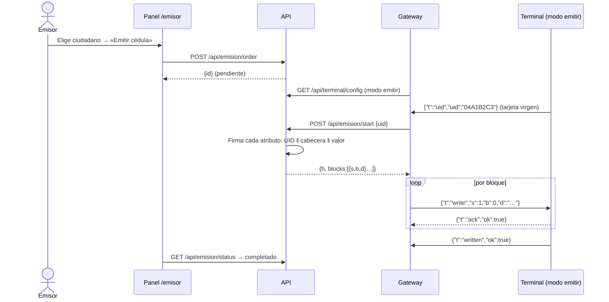
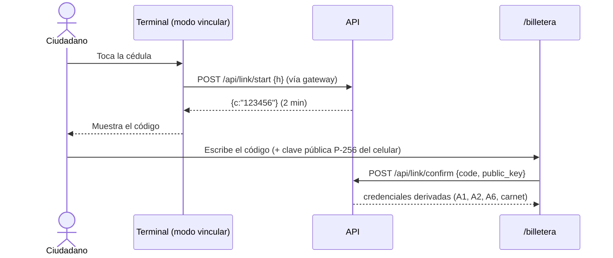
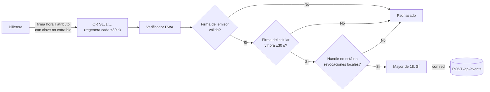
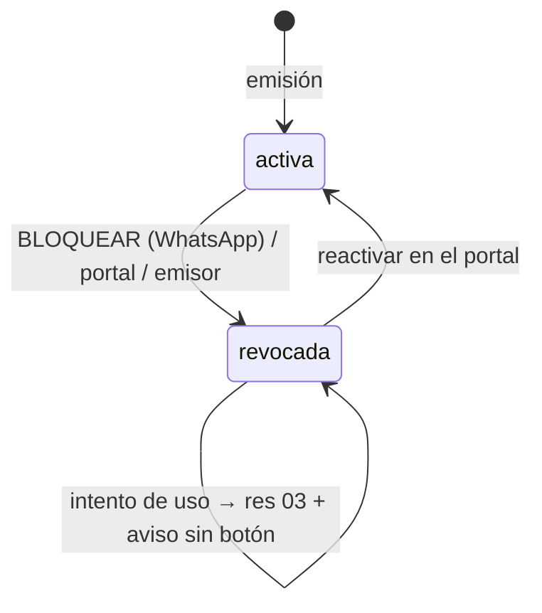

# 04 · Flujos

## 1. Verificación en terminal con aviso por WhatsApp (flujo estrella)

### Diagrama de flujo (decisión en el firmware)

```mermaid
flowchart TD
  A([Terminal en espera]) --> B[Muestra: '{local} pide: {dato}']
  B --> C{¿Ciudadano acepta?\nsolo si el modo no es emergencia}
  C -- No --> R6[res 06 · Rechazado]
  C -- Sí --> D[Acerca la cédula\n< 10 s]
  D --> E[Lee UID e índice: handle]
  E --> F{¿Hay índice válido?}
  F -- No --> X[Sin cédula: no hay evento\npor falta de handle]
  F -- Sí --> G{¿Handle en lista\nde revocación?}
  G -- Sí --> R3[res 03 · Revocada]
  G -- No --> H{¿Clave del rol abre\nlos sectores del dato?}
  H -- No --> R5[res 05 · Sin permiso]
  H -- Sí --> I[Lee registro del atributo]
  I --> J{¿Firma ECDSA válida\ncon UID + campos?}
  J -- No --> R2[res 02 · Firma inválida]
  J -- Sí --> K{¿Vigente con la hora\ndel gateway?}
  K -- No --> R4[res 04 · Vencida]
  K -- Sí --> R1[res 01 · Aprobado]
  R1 & R2 & R3 & R4 & R5 & R6 --> S[Voz + Nextion + pantalla comercio\nsolo con códigos]
  S --> T[Evento verif → gateway → POST /api/events]
  T --> U([Aviso WhatsApp, ver secuencia])
```

> Orden de comprobación en el firmware: el rechazo `06` ocurre antes de leer la tarjeta (no se lee ningún dato). Para `06` el handle aún no se conoce, así que el firmware debe leer solo el índice (sector 1, clave pública de todos los roles) para poder reportar el evento y avisar al dueño; el dato pedido no se toca.

### Diagrama de secuencia (terminal → WhatsApp)

```mermaid
sequenceDiagram
  autonumber
  actor Ana as Ciudadano
  participant FW as Terminal (ESP32 + RC522)
  participant GW as Gateway (Node)
  participant API as API Go (Render)
  participant DB as Postgres
  participant K as Kapso
  participant WA as WhatsApp de Ana

  Ana->>FW: Acerca la cédula
  FW->>FW: Lee handle, abre sectores con la clave del rol,\nverifica firma, vigencia y revocación
  FW-->>Ana: Voz y pantalla: concedido o denegado
  FW->>GW: {"t":"verif","h":"…","a":"A1","res":"01|02..06","ts":…}
  GW->>GW: Cola local (SQLite)
  GW->>API: POST /api/events (Bearer token del terminal)
  API->>DB: INSERT events; NOTIFY slj_events
  API-->>GW: {"ok":true}
  API->>DB: Dueño del handle: nombre y teléfono si avisos activos
  API->>K: POST /messages (texto o botones según res)
  K->>WA: "Hola Ana: se autorizó/negó el acceso en …"
  Ana->>WA: (opcional) Toca «Bloquear cédula»
  WA->>K: Respuesta
  K->>API: POST /api/webhooks/kapso (HMAC)
  API->>DB: Revoca cédulas, borra credenciales de billetera
  API->>K: "Tu cédula fue bloqueada…"
```

### Qué recibe el ciudadano según el resultado

| `res` | Situación | Mensaje | Botón Bloquear |
|---|---|---|---|
| 01 | Acceso autorizado | "se autorizó el acceso… compartió '{dato}' con {local}" (emergencia: lectura de sangre y contacto) | Sí |
| 02 | Firma inválida | "se negó el acceso… la firma de la tarjeta no es válida" | Sí |
| 03 | Cédula revocada | "se negó el acceso… tu cédula está bloqueada" | No |
| 04 | Vencida | "se negó el acceso… tu cédula está vencida" | Sí |
| 05 | Sin permiso | "{local} pidió '{dato}'… no se compartió nada" | Sí |
| 06 | Rechazada por el ciudadano | "se canceló el acceso… no aceptaste compartir" | Sí |

## 2. Emisión de una cédula



## 3. Vinculación de la billetera



## 4. QR dinámico y verificación sin red



## 5. Bloqueo y reactivación



## 6. Manipulación del terminal

```mermaid
sequenceDiagram
  participant PIC as PIC guardián
  participant FW as Terminal
  participant API
  participant K as Kapso
  PIC->>PIC: Tapa abierta o 10 s sin latido
  PIC->>FW: BLOQ en ALTO + corta alimentación del lector
  FW->>API: {"t":"tamper"} (vía gateway)
  API->>K: «Alerta: el terminal X detectó manipulación»
  Note over FW: Voz «terminal bloqueado»; REARME con precinto cerrado
```
