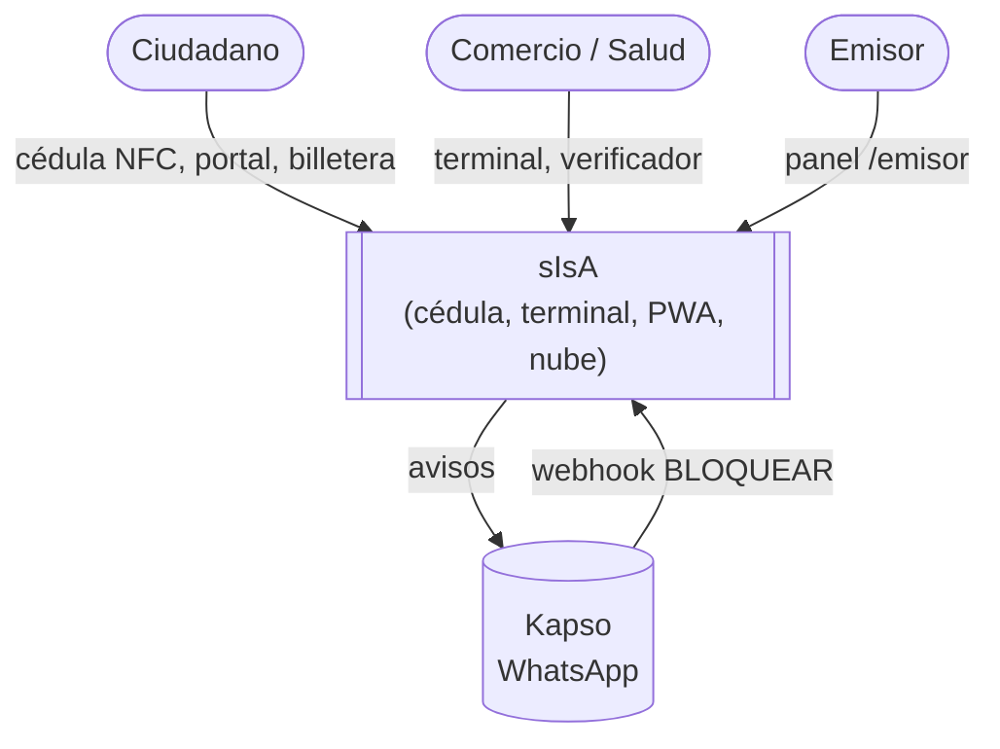
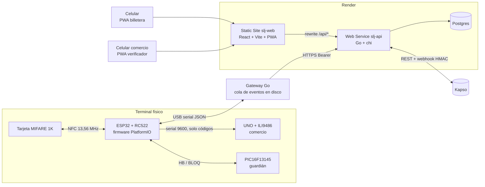
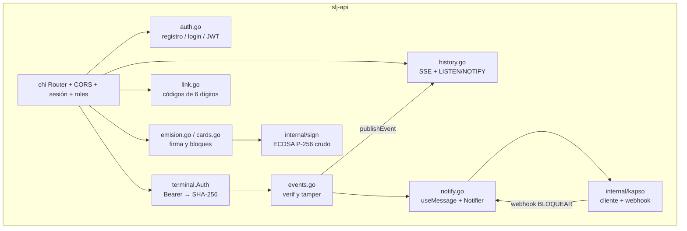

# 05 · Arquitectura de software

## Nivel 1 · Contexto

## Nivel 2 · Contenedores

| Contenedor | Tecnología | Ubicación en el repo |
|---|---|---|
| Firmware del lector | C++ / PlatformIO, MFRC522, micro-ecc, ArduinoJson | `firmware/esp32`, `firmware/rc522-diag` |
| Guardián | PIC16F13145, MPLAB X, CLB | `firmware/pic` |
| Pantalla del comercio | Arduino UNO + MCUFRIEND_kbv | `firmware/uno` |
| Gateway | Go, go.bug.st/serial, cola de eventos en archivos | `gateway/` |
| API | Go (chi, pgx), JWT, bcrypt | `api/` |
| Base de datos | Postgres (migraciones SQL) | `db/migrations` |
| Front y PWAs | React, TypeScript, Vite, Tailwind, WebCrypto, IndexedDB | `web/` (núcleo QR en `web/src/lib/slj`) |
| Herramientas | Verificador independiente en Node, claves públicas | `tools/`, `keys/` |

## Nivel 3 · Componentes de la API

## Decisiones de arquitectura (ADR resumidos)

| ADR | Decisión | Motivo | Consecuencia |
|---|---|---|---|
| 1 | ESP32 + RC522 en vez de Mega + PN532 | Disponibilidad del kit; ESP32 con más memoria para micro-ecc | Pines y alimentación documentados en `rc522-diag`; el RC522 solo lee MIFARE |
| 2 | Firma ECDSA P-256 `r‖s` de 64 B con el UID dentro del mensaje | Mismo algoritmo en Go, WebCrypto y micro-ecc; impide copiar un atributo a otra tarjeta | Vectores compartidos en `docs/test-vectors.json` |
| 3 | Handle seudónimo en vez de datos personales en eventos | El historial no revela identidad al terminal ni al comercio | La API une handle → ciudadano solo para el dueño |
| 4 | Verificación offline en el terminal | Sin dependencia de red en el punto de uso | Revocaciones sincronizadas cada 60 s por el gateway |
| 5 | Avisos en segundo plano (`goNotify`) | Un fallo o demora de Kapso no frena al terminal | El evento queda guardado aunque falle el aviso |
| 6 | Aviso en **todos** los resultados | El ciudadano detecta intentos denegados (copias, terminales sin permiso) | Más mensajes; respeta `notifications` por cuenta |
| 7 | Todo en Render (Go + Postgres + estático) | Un `render.yaml`, URL pública para el webhook | Arranque en frío del plan gratuito |
| 8 | Guardián PIC independiente | Bloqueo por hardware aunque el firmware sea comprometido | Requiere REARME tras cada grabación |

## Despliegue

`render.yaml` define `slj-api` (Go, `rootDir: api`, health `/api/health`) y `slj-web` (estático, rewrite `/api/*` hacia la API y `/*` a `index.html`). Variables en [08](08-despliegue-operacion.md).

## Mapa con el grafo de conocimiento (graphify)

Comunidades detectadas: utilidades binarias (`bytes.ts`), códec y criptografía del QR (`web/src/lib/slj`), CLI y pruebas en Go, almacén IndexedDB, verificación QR y laboratorio, despliegue Render. Nodos centrales: `verifyPresentation()`, `parsePresentation()`, `Presentacion QR SLJ1`. Tras la fusión se recomienda re-ejecutar `/graphify` para incorporar la API, el firmware y estos documentos.
