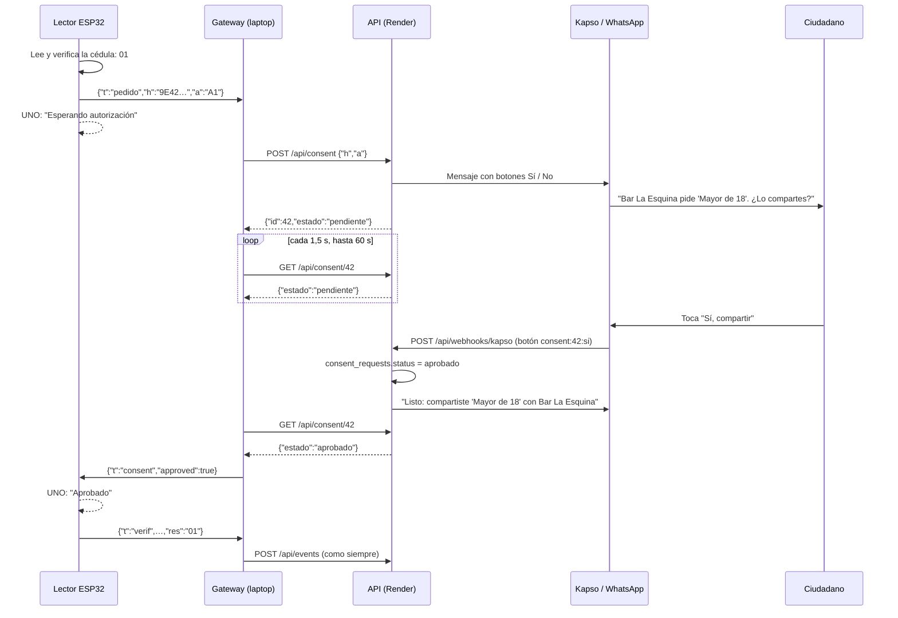

# Consentimiento por WhatsApp

Guía para quien implemente la parte de la API y Kapso. El lector (ESP32), la pantalla del comercio (UNO) y el contrato ya están hechos y probados en placa. La API (sección 4) y el gateway (sección 6) también están hechos.

## 1. Qué cambió

Antes, el ciudadano tocaba **Aceptar** en una pantalla Nextion y después acercaba la cédula. La Nextion se eliminó del proyecto. Ahora:

1. El comercio pide un dato (por ejemplo "Mayor de 18") y el ciudadano acerca la cédula.
2. El lector la lee y verifica la firma, la vigencia y la revocación **sin internet**, como antes.
3. Si el resultado es **`01` (aprobado)**, el lector **no lo muestra todavía**. Le pide permiso al ciudadano por WhatsApp y el UNO muestra "Esperando autorización".
4. El ciudadano toca **Sí** o **No** en WhatsApp.
5. Con **Sí**, el UNO muestra "Aprobado" y se registra el `01`. Con **No**, o si pasan 60 s sin respuesta, se registra `06` (rechazado).

Los resultados `02`, `03`, `04` y `05` no piden permiso: se muestran y se registran de inmediato, como hasta ahora, porque no hay un dato válido que compartir.

## 2. Recorrido completo



## 3. Lo que ya está hecho (no tocar)

| Pieza | Qué hace | Dónde |
|-|-|-|
| Lector | Envía `pedido` tras un `01`, espera `consent` 60 s, después envía `verif` con `01` o `06` | `firmware/esp32/src/main.cpp` (`resolverLectura`, `onGatewayConsent`) |
| UNO | Pantalla ámbar "Esperando autorización" con `{"t":"wait","a":"A1"}` | `firmware/uno/src/main.cpp` |
| Contrato | Mensajes `pedido`, `consent` y `wait` | [`contrato-terminal.md`](contrato-terminal.md) |

Para probar sin WhatsApp, en el monitor serie del ESP32 `a` aprueba y `r` rechaza.

## 4. Lo que tienes que hacer en la API

Todo sigue el mismo patrón que ya existe para BLOQUEAR (`api/internal/api/notify.go`) y para los códigos de vinculación (`api/internal/api/link.go`).

### 4.1 Migración `db/migrations/000007_consent.up.sql`

```sql
CREATE TABLE consent_requests (
    id          BIGSERIAL PRIMARY KEY,
    handle      BYTEA NOT NULL REFERENCES cards(handle) ON DELETE CASCADE,
    terminal_id BIGINT NOT NULL REFERENCES terminals(id) ON DELETE CASCADE,
    attribute   SMALLINT NOT NULL CHECK (attribute BETWEEN 1 AND 6),
    phone       TEXT NOT NULL,
    status      TEXT NOT NULL DEFAULT 'pendiente'
                CHECK (status IN ('pendiente', 'aprobado', 'rechazado')),
    created_at  TIMESTAMPTZ NOT NULL DEFAULT now(),
    expires_at  TIMESTAMPTZ NOT NULL,
    answered_at TIMESTAMPTZ
);
CREATE INDEX consent_requests_pending_idx ON consent_requests (phone, created_at DESC)
    WHERE status = 'pendiente';
```

Y `000007_consent.down.sql`:

```sql
DROP TABLE consent_requests;
```

"Vencido" no se guarda: es un `pendiente` con `expires_at < now()`.

### 4.2 Rutas nuevas (grupo de terminales)

En `Routes`, dentro del grupo con `terminal.Auth(s.DB)` (`api/internal/api/server.go`):

```go
r.Post("/api/consent", s.consentStart)
r.Get("/api/consent/{id}", s.consentStatus)
```

Conviene crearlas en un archivo nuevo, `api/internal/api/consent.go`.

**`POST /api/consent`**, cuerpo `{"h":"9E429475799FC8ED","a":"A1"}`:

1. `parseHandle(in.H)` y `parseAttr(in.A)`, que ya existen. Si fallan: 400.
2. Buscar la cédula y su dueño:
   ```sql
   SELECT k.status, c.name, c.whatsapp_phone, c.notifications
     FROM cards k LEFT JOIN citizens c ON c.id = k.citizen_id
    WHERE k.handle = $1
   ```
   - No existe: **404** `{"ok":false,"error":"cédula desconocida"}`.
   - Revocada: **409**. El lector ya lo detecta con su lista, pero por si acaso.
   - Sin teléfono o con `notifications = false`: **422** `{"ok":false,"estado":"sin_whatsapp"}`. El gateway le avisa al operador, que puede responder a mano.
3. Insertar con `expires_at = now() + 60 s`. Usar la misma duración que el lector (`CONSENT_TIMEOUT_MS` en `firmware/esp32/include/config.h`).
4. Enviar el WhatsApp **en segundo plano** con `s.goNotify` (sección 4.4), para no hacer esperar al gateway.
5. Responder **200** `{"ok":true,"id":42,"estado":"pendiente"}`.

**`GET /api/consent/{id}`**:

1. Leer la solicitud, **solo si `terminal_id` es el del terminal autenticado**. Si no, 404.
2. Responder `{"ok":true,"id":42,"estado":"pendiente|aprobado|rechazado|vencido"}`. Es `vencido` cuando está `pendiente` y `expires_at < now()`.

### 4.3 Webhook de Kapso

En `kapsoWebhook` (`notify.go`), el bucle hoy solo atiende `m.IsBlock()`. Agrega antes una rama para el consentimiento:

```go
for _, m := range msgs {
    if id, ok, es := m.Consent(); es {        // nuevo, ver abajo
        if err := s.answerConsent(r.Context(), m.From, id, ok); err != nil {
            log.Printf("consentimiento por WhatsApp: %v", err)
        }
        continue
    }
    if !m.IsBlock() { continue }
    …
}
```

En `api/internal/kapso/kapso.go`, agrega a `Incoming`:

```go
// Consent reconoce la respuesta a una solicitud: botón "consent:<id>:si|no" o texto SI/NO.
// id = 0 con texto: se aplica a la última solicitud pendiente de ese teléfono.
func (m Incoming) Consent() (id int64, aprobado bool, es bool)
```

- Botón: `ButtonID` con la forma `consent:42:si` o `consent:42:no`.
- Texto, como respaldo: `si`, `sí` y `no`, sin importar mayúsculas ni signos, igual que hace `IsBlock`.

`answerConsent(ctx, phone, id, aprobado)`:

1. Actualizar **solo si sigue pendiente, no venció y el teléfono coincide**. Así la primera respuesta gana y nadie responde por otro:
   ```sql
   UPDATE consent_requests
      SET status = $1, answered_at = now()
    WHERE status = 'pendiente' AND expires_at > now() AND phone = $2
      AND id = COALESCE(NULLIF($3, 0),
               (SELECT id FROM consent_requests
                 WHERE phone = $2 AND status = 'pendiente' AND expires_at > now()
                 ORDER BY created_at DESC LIMIT 1))
   RETURNING attribute, terminal_id
   ```
2. Si actualizó una fila, confirmar por WhatsApp con texto:
   - Sí: "Listo: compartiste 'Mayor de 18' con Bar La Esquina."
   - No: "No se compartió nada."
3. Si no actualizó nada (venció, ya respondida o teléfono ajeno), contestar "Esa solicitud ya no está activa." o no contestar.

### 4.4 El mensaje

En `notify.go`, junto a `useMessage`:

```go
func consentMessage(name, local string, attr int) string {
    // "Hola Ana: Bar La Esquina pide 'Mayor de 18'. ¿Lo compartes? Solo se comparte ese dato."
}
```

Enviar con `SendButtons` y **dos** botones (máximo 20 caracteres por título):

```go
[]kapso.Button{
    {ID: fmt.Sprintf("consent:%d:si", id), Title: "Sí, compartir"},
    {ID: fmt.Sprintf("consent:%d:no", id), Title: "No compartir"},
}
```

Si `SendButtons` falla, mandar el texto con "Responde SI o NO.", igual que hace `sendBlockable`.

### 4.5 No duplicar avisos

Hoy `notifyUse` manda un WhatsApp por **cada** `verif`. Con el consentimiento, Ana recibiría la pregunta, la confirmación y además "se autorizó el acceso… ¿No fuiste tú?". En `notifyUse`, **omitir el aviso** de un `verif` `01` o `06` sin emergencia cuando hay una `consent_requests` del mismo `handle` y del mismo terminal respondida o creada en los últimos 2 minutos: ya recibió la pregunta y la confirmación.

Hay un caso a definir con el equipo: un `06` por **tiempo agotado** (Ana no respondió). Propuesta: mandar "La solicitud de Bar La Esquina venció y no se compartió nada."

### 4.6 Pruebas

En `api/internal/api/notify_test.go` (unitarias):
- `consentMessage` con y sin nombre.
- `Incoming.Consent()`: botón `consent:42:si`, `consent:42:no`, texto `Sí`, texto `NO.` y `bloquear` (que no debe confundirse).

En `api/internal/api/kapso_integration_test.go` (con Postgres, `SLJ_INTEGRATION=1`), siguiendo los casos de BLOQUEAR:
1. `POST /api/consent` envía botones al teléfono de Ana y devuelve `pendiente`.
2. Webhook firmado con `consent:<id>:si` → `GET` da `aprobado` y Ana recibe la confirmación.
3. Una segunda respuesta no cambia nada.
4. Una respuesta desde otro teléfono se ignora.
5. Pasado `expires_at`, `GET` da `vencido` y una respuesta tardía se ignora.
6. Ciudadano sin teléfono → 422.
7. Otro terminal no puede consultar el `id` → 404.
8. Después de un `verif` `01` aprobado por WhatsApp, `notifyUse` no envía el aviso duplicado.

### 4.7 Probar a mano sin hardware

Con la API en local y el token de "Bar La Esquina" de `secrets/demo.json`:

```bash
curl -s -X POST localhost:8080/api/consent -H "Authorization: Bearer $TOK" \
     -H 'Content-Type: application/json' -d '{"h":"<handle de Ana>","a":"A1"}'
curl -s localhost:8080/api/consent/1 -H "Authorization: Bearer $TOK"
```

El handle de Ana sale de `docs/tarjetas-prueba.json`, o de `SELECT encode(handle,'hex') FROM cards`.

## 5. Kapso y WhatsApp en la demo

- **Ventana de 24 horas:** fuera de las 24 h desde el último mensaje del ciudadano al número de Kapso, WhatsApp no deja enviar mensajes con botones, salvo con una **plantilla aprobada por Meta**, y aprobarla tarda. Para la demo: **desde el teléfono de "Ana", escribir "hola" al número de Kapso antes de empezar.** Así funcionan los botones de consentimiento y también los de BLOQUEAR.
- **Webhook:** en Kapso, el webhook `whatsapp.message.received` debe apuntar a `https://<api en Render>/api/webhooks/kapso`, con el mismo secreto que `KAPSO_WEBHOOK_SECRET`.
- **Teléfonos de demo:** `go -C api run ./cmd/admin demo -ana 0424… -luis … -maria …` les asigna los números. Quien presente como Ana debe tener ese teléfono en la mano.
- **Plan B:** si la API responde 422 (titular sin WhatsApp o con los avisos apagados) o no responde, el gateway le pide la respuesta al operador: `si` o `no` en su consola (sección 6). Para usarlo a propósito en la demo, desactivar los avisos de la cuenta del titular en el portal: la API responde 422. Con el gateway cerrado, en el monitor serie del ESP32 están `a` y `r`.
- **La API acepta pero el mensaje no llega:** WhatsApp acepta el envío aunque después no lo entregue. El motivo (más de 24 h sin que el titular escriba al número, número de prueba de Meta que solo escribe a destinatarios autorizados, número equivocado) aparece como estado `failed` en el panel de Kapso, no como error en los logs de la API. En el gateway se ve "solicitud N creada" y, 60 s después, "venció sin respuesta".

## 6. Gateway (hecho)

Implementado en `gateway/internal/puente/consentimiento.go`, con el cliente en `gateway/internal/api/api.go` y el mensaje en `gateway/internal/protocolo/protocolo.go`:

1. `pedido` del lector → `POST /api/consent` con el token del terminal activo. El gateway escribe "solicitud N creada" cuando la API la acepta.
2. Consulta `GET /api/consent/{id}` cada 1,5 s hasta `aprobado` (→ `{"t":"consent","approved":true}`), `rechazado` o `vencido` (→ `approved:false`), o hasta 65 s. Pasado ese plazo no envía nada: el lector ya dio `06`.
3. Con 422 (`sin_whatsapp`) o sin red, le pide al operador «si» o «no» en la consola. Los demás 4xx (cédula desconocida o revocada) se rechazan de inmediato, sin reintentar. Un error de red mientras consulta no corta la espera.
4. Mientras se espera la respuesta por WhatsApp, `si`/`no` no hacen nada: el operador no puede responder por el titular.
5. Un pedido nuevo anula al anterior, así una respuesta vieja nunca llega a una lectura nueva.
6. Pruebas en `gateway/internal/puente/puente_test.go`: aprobado, rechazado, vencido, sin respuesta, cédula revocada, sin WhatsApp, API caída, consola sin pedido y pedido nuevo.

## 7. Documentación

Ya describen el flujo nuevo: `02-srs.md` (RF-17), `03-casos-de-uso.md` (CU-01), `04-flujos.md`, `07-seguridad-privacidad.md` y `09-pruebas.md`. Cuando implementes la API, agrega:

| Archivo | Cambio |
|-|-|
| `docs/contrato-terminal.md`, enlace 4 | `POST /api/consent` y `GET /api/consent/{id}` en la tabla de endpoints |
| `docs/06-modelo-datos.md` | La tabla `consent_requests` en el diagrama entidad-relación |
| `docs/09-pruebas.md` | Los casos de la sección 4.6 y sus resultados |
